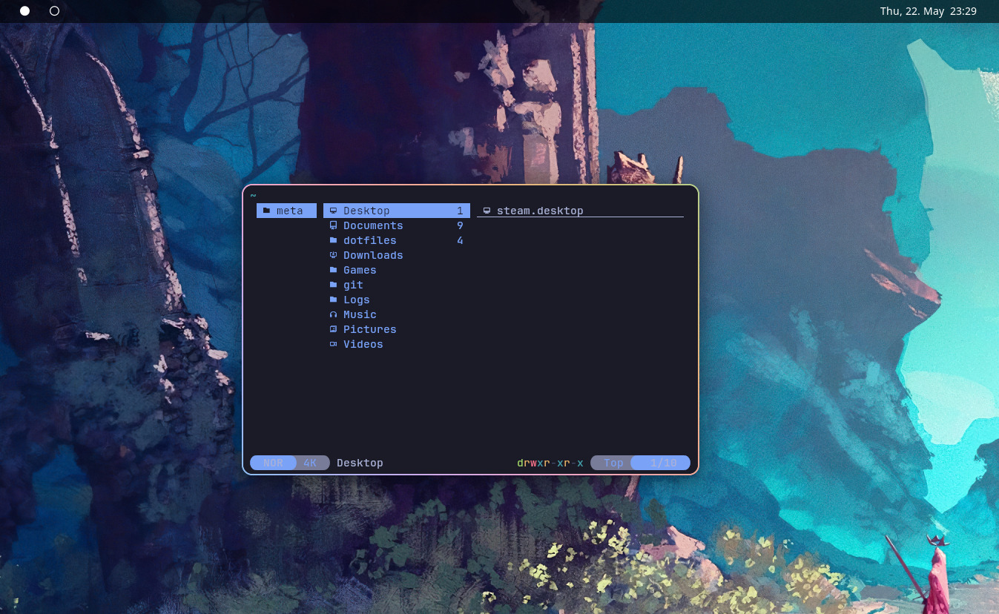

## as of `9dd6b0`


### Install with GNU/stow
`cd dots && stow -t ~ *`

### yazi as file picker (`portal`)
One-time setup outside stow:
```sh
nix profile install nixpkgs#xdg-desktop-portal-termfilechooser
mkdir -p ~/.local/share/dbus-1/services
ln -sf ~/.nix-profile/share/dbus-1/services/org.freedesktop.impl.portal.desktop.termfilechooser.service ~/.local/share/dbus-1/services/
sudo ln -s ~/.nix-profile/share/xdg-desktop-portal/portals/termfilechooser.portal /usr/share/xdg-desktop-portal/portals/
systemctl --user daemon-reload && systemctl --user restart xdg-desktop-portal
```
